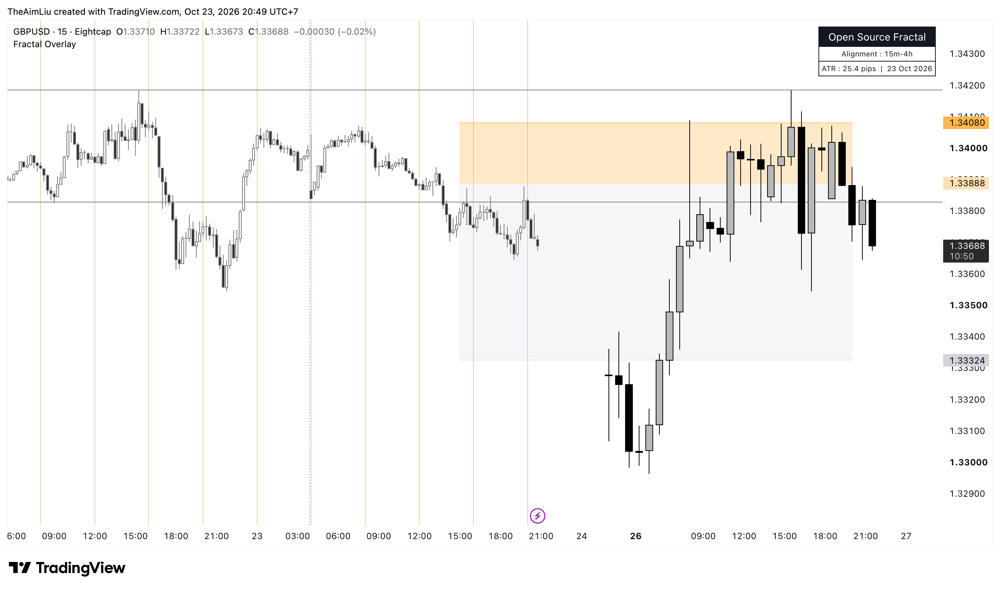

# Fractal Overlay Indicators

## How to install
paste the [code](script/ict-fractal.pine) inside pinescript Tradingview

## How to use/ read the indicator
The indicator was based on [`ICT fractal model` created by Cantolab](https://github.com/cantolab/open-source-fractal). I had generalized it a bit more so we could apply it on more strategic outlook i.e. CRT, ICT, etc.
- I don't think we needed many plots so using Tradingview [horizontal line or horizontal ray](https://www.tradingview.com/support/solutions/43000518124-horizontal-line-drawing-tool/) should be enough

## See also
- [CRT Community Twitter](https://x.com/i/communities/1948763019141394839)
- [TTrade Educational Resources](https://ttrades.com/trading-education-center/)